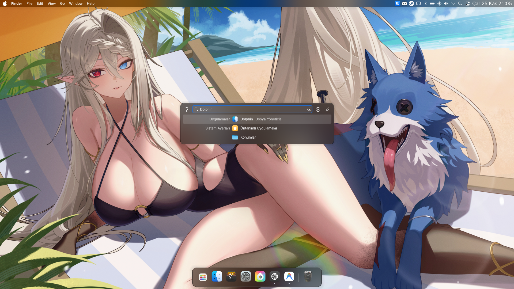
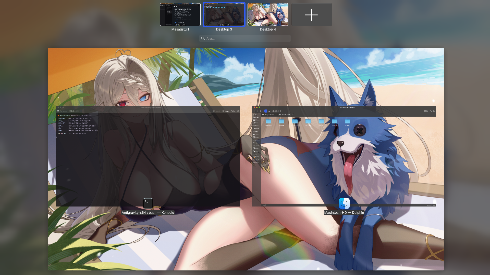
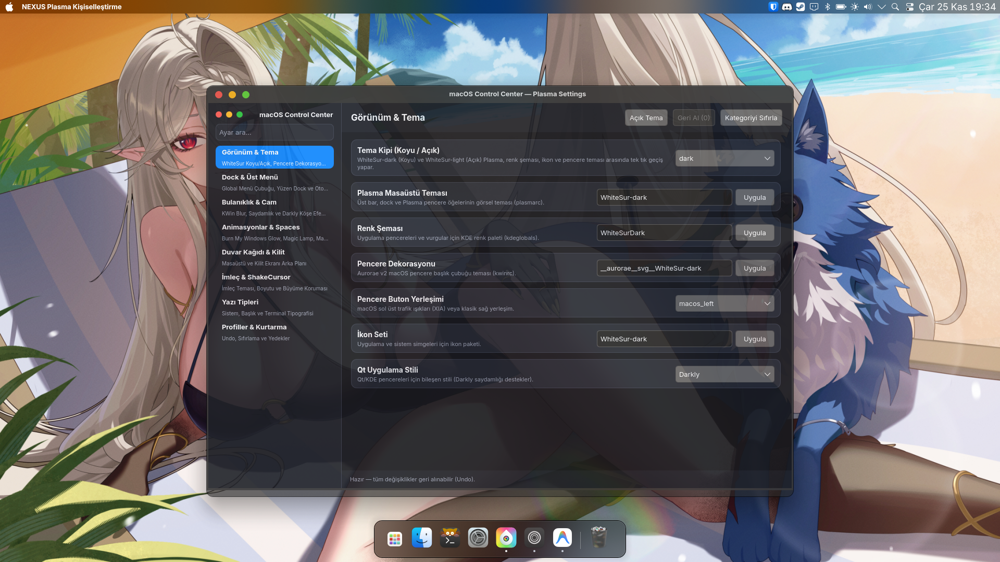
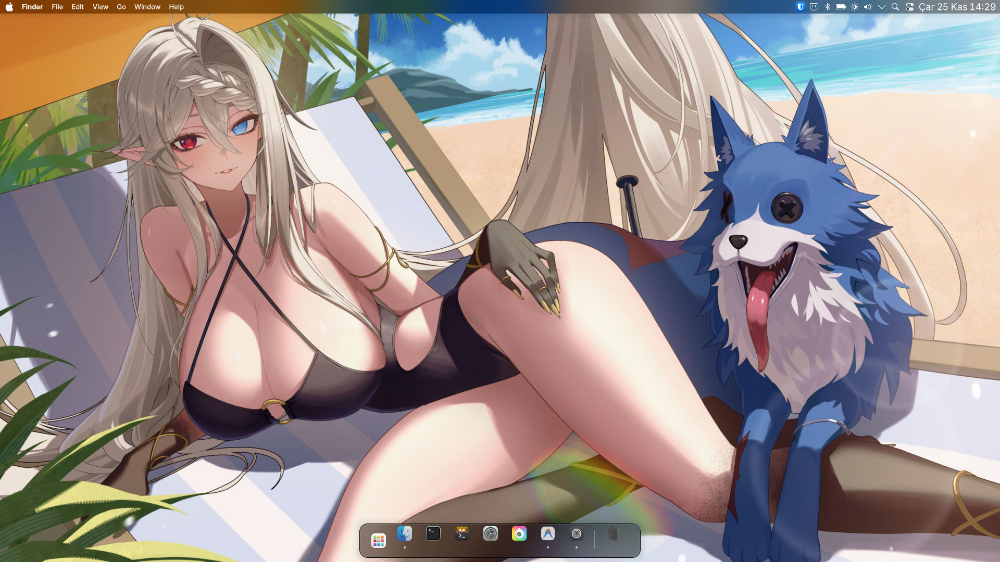

# Sonoma Plasma

> A handcrafted macOS Sonoma desktop environment for **KDE Plasma 6 (Wayland)** — bringing together a cosine-wave floating dock, an active-app Finder menu bar, **Burn My Windows Aura Glow**, selective vibrancy glass, and a native QtQuick Control Center.

`KDE Plasma 6.8+` · `Wayland` · `KWin 6` · `WhiteSur` · `Darkly` · `PySide6 / QtQuick` · [🇹🇷 Türkçe Rehber](docs/README.tr.md) · [⚙️ Customization Guide](docs/CUSTOMIZATION.md)



---

## Visual Tour

| Mission Control & Spaces | Translucent Terminal & Global Menu |
| :--- | :--- |
|  |  |
| Organized window grid with horizontal Spaces (`Meta + Up` / `Meta + Tab`). | Live Global Menu (`Konsole`) paired with `Darkly` + KWin Vibrancy blur. |

| macOS Control Center | Clean Desktop |
| :--- | :--- |
|  |  |
| 8 live setting categories, Dark/Light 5-layer sync, profiles & SHA-256 undo (`Meta + I`). | Slim `26px` translucent menu bar with Apple menu, Finder menus & 2-pill Control Center icon. |

### Cosine-Wave Dock Magnification (`44px → 64px`)

<p align="center">
  
</p>

Built from scratch as a Plasma 6 `TaskManager.TasksModel` plasmoid (`com.nexus.macosdock`) with `roundToIconSize: false` so every icon scales continuously at 60+ FPS with smooth neighboring wave falloff, full-color Launchpad (`view-app-grid`), running dots, and Trash.

---

## Quick Install

```bash
git clone https://github.com/sudoivonx/sonoma-plasma.git
cd sonoma-plasma
./install.sh --dry-run   # preview every change safely first
./install.sh             # backs up your current KDE/GTK configs & applies Sonoma Plasma
```

<details>
<summary><strong>Installer flags, SDDM login screen & clean rollback</strong></summary>

### Installer Options
| Flag | Behavior |
| :--- | :--- |
| `--dry-run` | Print planned actions without touching any files or packages. |
| `--skip-packages` | Skip system package installation (`dnf` / `pacman` / `apt`). |
| `--skip-themes` | Skip cloning/installing WhiteSur KDE, Icon, and Cursor themes. |
| `--with-sddm` | Also install the bundled WhiteSur SDDM login theme (prompts for `sudo`). |
| `--no-backup` | Skip automatic pre-install backup. |
| `-y, --yes` | Run non-interactively. |

### Rollback / Uninstall
Your pre-install KDE & GTK configs are automatically backed up to `~/.local/state/sonoma-plasma/backups/latest`. To restore everything cleanly:
```bash
./scripts/uninstall.sh
# If SDDM was applied:
sudo ~/.local/share/kde-macos/sddm/rollback-sddm-macos.sh
```

</details>

---

## What Makes It Different

### 1. Native-Feeling Top Bar & Global Menu
- **Always-present macOS menu flow (`com.nexus.macosmenubar`):** Displays the focused application's name in bold right beside the Apple menu, seamlessly joining KDE's live Global Menu (`appmenu`). On an empty desktop, it presents a working **`Finder  File  Edit  View  Go  Window  Help`** bar.
- **Minimal monochrome right side:** Cluttered background icons are tucked into the tray drawer, leaving network/Bluetooth/audio/power icons, **Spotlight (`milou`)**, a custom **2-pill Control Center toggle (`com.nexus.macoscontrolcenter`)**, and a single clean clock.

### 2. Motion & Visual Depth
- **Burn My Windows — Aura Glow (`KWin/Effect`):** Upstream GLSL ES 3.20 / HDR Aura Glow effect packaged in user space (`~/.local/share/kwin/effects/glow/`) for smooth window open/close transitions (`scale` disabled).
- **Magic Lamp & Spaces:** `magiclamp` (`280ms`) Genie minimize into the dock, `slide` across horizontal Spaces, `overview` Mission Control, and `windowview` App Exposé.
- **Selective Vibrancy Glass:** Instead of making every window unreadable, KWin window rules (`kwinrulesrc`) + `Darkly` apply frosted translucency (`88%–90%` active, `84%–86%` inactive) selectively to **Dolphin, System Settings, Konsole, Kitty, and Control Center**, leaving browsers, media players, and code editors 100% opaque.

### 3. Control Center & Daily Ergonomics
- **Live QtQuick Control Center (`Meta + I`):** Adjust Dark/Light mode (5-layer KDE + Aurorae + GTK2/3/4 + `gsettings`), Dock/Bar live geometry, Blur & Darkly vibrancy, Glow/Magic Lamp/Spaces, Wallpaper & Lockscreen, Cursor, Typography, and Profiles with SHA-256 conflict-checked **Undo** and **Reset**.
- **No Growing Cursor Bug:** Disables KDE Plasma 6's `shakecursor` effect and locks `WhiteSur-cursors` at `24px` across KDE, GTK, and Wayland.
- **Manual Lock Only:** `kscreenlockerrc` keeps `Autolock=false`, `LockOnResume=false`, and `Timeout=0` while applying the bundled `2504×1408` wallpaper (`wallpapers/default.jpg`) to both desktop and lockscreen.

---

## Keyboard Shortcuts

| Shortcut | Action |
| :--- | :--- |
| `Meta + Space` / `Alt + Space` | Spotlight Search (centered floating KRunner) |
| `Meta + Up` / `Meta + Tab` | Mission Control (`Overview`) |
| `Meta + Down` | App Exposé (current application windows) |
| `Ctrl + Left` / `Ctrl + Right` | Switch Spaces (virtual desktops) |
| `Meta + A` | Launchpad (full-screen app grid) |
| `Meta + I` | Open macOS Control Center |

---

<details>
<summary><strong>Repository Structure</strong></summary>

```text
sonoma-plasma/
├── install.sh                         # Multi-distro installer (Fedora / Arch / Debian-Ubuntu)
├── scripts/uninstall.sh               # Clean rollback to pre-install backup
├── docs/
│   ├── README.tr.md                   # Full Turkish documentation
│   └── CUSTOMIZATION.md               # Tweaking Glow, Dock, Vibrancy & shortcuts
├── wallpapers/default.jpg             # Bundled 2504×1408 default wallpaper
├── assets/screenshots/                # Live desktop captures
├── config/                            # Portable KDE Plasma 6 & GTK2/3/4 configs
└── local/
    ├── kwin/effects/glow/             # Burn My Windows Aura Glow KWin 6 effect
    ├── plasma/plasmoids/              # macosdock, macosmenubar, macoscontrolcenter
    ├── control-center/                # PySide6/QtQuick Control Center + unit tests
    ├── applications/                  # Desktop entry
    └── sddm/                          # Optional WhiteSur SDDM theme & scripts
```

</details>

---

## Credits & Upstream Projects

Sonoma Plasma builds on the work of these open-source projects:
- [**vinceliuice/WhiteSur-kde**](https://github.com/vinceliuice/WhiteSur-kde), [**WhiteSur-icon-theme**](https://github.com/vinceliuice/WhiteSur-icon-theme) & [**WhiteSur-cursors**](https://github.com/vinceliuice/WhiteSur-cursors) — Plasma desktop theme, Aurorae window decoration, icons, cursors, and SDDM base theme.
- [**Schneegans/Burn-My-Windows**](https://github.com/Schneegans/Burn-My-Windows) — Upstream **Aura Glow** shader adapted for KWin 6 Wayland (GLES 3.20 / HDR).
- [**Bali10050/Darkly**](https://github.com/Bali10050/Darkly) — Translucent Qt 6 / KDE application style.
- **KDE Community** — KDE Plasma 6, KWin 6, and Kirigami.

Licensed under the [MIT License](LICENSE).
