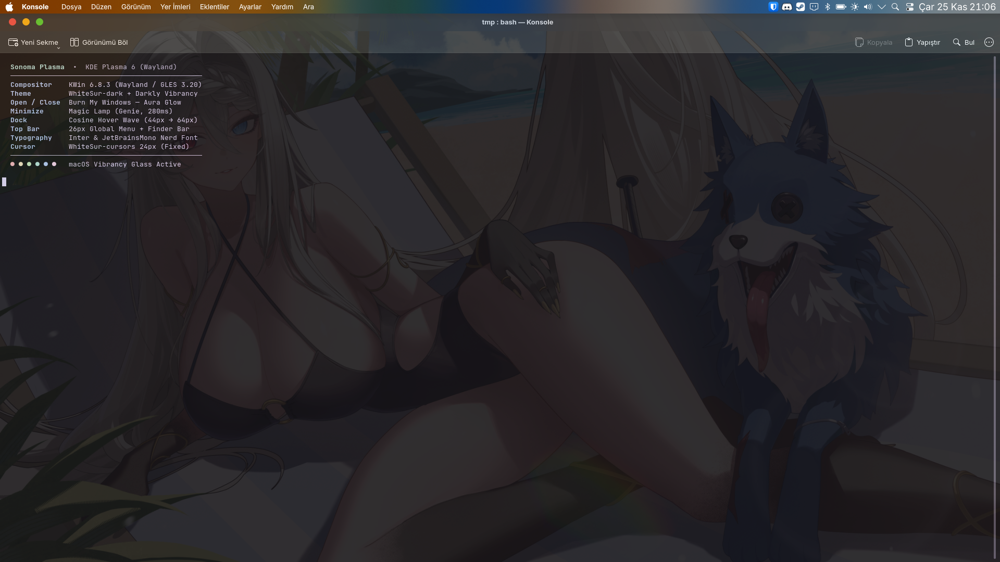
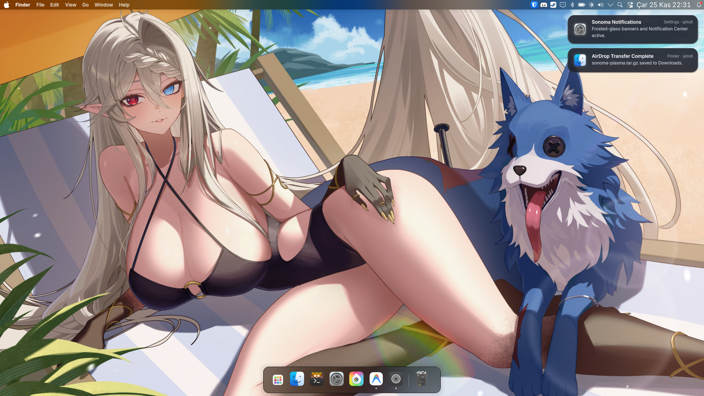

# Sonoma Plasma

> A handcrafted macOS Sonoma desktop transformation for **KDE Plasma 6 (Wayland)** — featuring a custom cosine-wave floating dock, an active-app Finder menu bar, frosted-glass **macOS Sonoma notifications**, **Burn My Windows — Aura Glow**, selective vibrancy glass, and a native PySide6/QtQuick **macOS Control Center**.

> **KDE Plasma 6 (Wayland)** için özenle hazırlanmış, bütünsel bir macOS Sonoma masaüstü deneyimi — kosinüs dalgalı büyüyen Dock, aktif uygulamayı gösteren Finder üst menü çubuğu, buzlu cam **macOS Sonoma bildirimleri**, **Burn My Windows — Aura Glow** açılış/kapanış efekti, seçici buzlu cam (Vibrancy) ve yerel **macOS Kontrol Merkezi**.

`KDE Plasma 6.8+` · `Wayland` · `KWin 6` · `WhiteSur` · `Darkly` · `Burn My Windows Aura Glow` · `PySide6 / QtQuick`

[**🇬🇧 English Guide**](#-english-guide) · [**🇹🇷 Türkçe Detaylı Rehber**](#-türkçe-detaylı-rehber) · [**📸 Visual Tour**](#-visual-tour--ekran-görüntüleri) · [**🚀 Installation / Kurulum**](#-installation) · [**⌨️ Shortcuts / Kısayollar**](#-keyboard-shortcuts) · [**⚙️ Customization**](docs/CUSTOMIZATION.md) · [**🙏 Credits**](#-credits--attribution--taban-projeler-ve-teşekkür)


---

## 📸 Visual Tour / Ekran Görüntüleri

| Mission Control & Spaces | Translucent Terminal & Global Menu |
| :--- | :--- |
|  |  |
| Organized window grid with horizontal Spaces (`Meta + Up` / `Meta + Tab`).<br>*Yatay masaüstleri (Spaces) ve düzenli pencere ızgarası (`Meta + Up` / `Meta + Tab`).* | Live Global Menu (`Konsole`) paired with `Darkly` + KWin Vibrancy blur.<br>*Canlı Global Menü (`Konsole`) ile `Darkly` + KWin Vibrancy buzlu cam uyumu.* |

| macOS Control Center (`Meta + I`) | macOS Sonoma Notifications |
| :--- | :--- |
|  |  |
| 8 live categories, 34 settings, Dark/Light 5-layer sync, profiles & SHA-256 undo.<br>*8 canlı kategori, 34 ayar, 5 katmanlı Koyu/Açık geçiş, profiller ve SHA-256 geri alma.* | Frosted-glass top-right banners (`com.nexus.macosnotifications`) with hover close pill & Notification Center.<br>*Sağ üstte buzlu cam macOS bildirim kartları (`com.nexus.macosnotifications`), kapatma kapsülü ve Bildirim Merkezi.* |

### Cosine-Wave Dock Magnification (`44px → 64px`) / Kosinüs Dalgalı Dock Büyümesi

<p align="center">
  
</p>

*Custom Plasma 6 `TaskManager.TasksModel` plasmoid (`com.nexus.macosdock`) with `roundToIconSize: false` for continuous 60+ FPS cosine hover magnification, color Launchpad, running dots, hairline divider, and Trash.*  
*`roundToIconSize: false` ile kesintisiz 60+ FPS kosinüs dalgalı büyüme sunan özel Plasma 6 Dock eklentisi (`com.nexus.macosdock`), renkli Launchpad, çalışan uygulama göstergeleri, ince ayırıcı ve Çöp Kutusu.*

---

# 🇬🇧 English Guide

## Design Philosophy & Architecture

Most Linux macOS themes stop at swapping an icon pack and moving window buttons to the left. **Sonoma Plasma** goes further by aligning **appearance, compositor motion, desktop workflow, and live configuration** into one cohesive KDE Plasma 6 Wayland setup without sacrificing daily usability or readability:

1. **Native-Feeling Chrome (`Top Bar` + `Dock`):** Built with lightweight, zero-lag Plasma 6 QML applets instead of heavy third-party dock daemons that break on Wayland.
2. **Smooth Compositor Motion (`KWin 6`):** Combines upstream **Burn My Windows — Aura Glow** (GLES 3.20 / HDR) for window open/close with **Magic Lamp** (`280ms`) Genie minimization, horizontal **Slide** across Spaces, and **Mission Control (`Overview`)**.
3. **Selective Vibrancy Glass (`Darkly` + `kwinrulesrc`):** Real macOS keeps browsers, videos, and code readable while giving Finder, System Settings, menus, and terminals frosted depth. Sonoma Plasma mirrors that exact balance.
4. **Live Control Center (`PySide6 / QtQuick`):** Every major visual and behavioral knob—from Dark/Light mode and blur strength to Glow duration and dock height—is editable live from one macOS-styled window (`Meta + I`) with SHA-256 conflict-checked **Undo** and **Reset**.

---

## Detailed Component Breakdown

### 1. Authentic macOS Sonoma Top Bar (`26px`, Translucent)
- **Apple Menu (`org.kde.plasma.kicker`):** Uses WhiteSur's Apple icon (`start-here-kde`) on the top-left corner.
- **Active App Title & Finder Bar (`com.nexus.macosmenubar`):** Reads the currently focused window via `TaskManager.TasksModel` and displays its name in bold `Inter` right next to the Apple menu, flowing seamlessly into KDE's live Global Menu (`org.kde.plasma.appmenu`). When no window is focused on the desktop, it presents a working **`Finder  File  Edit  View  Go  Window  Help`** menu with real quick actions (New Finder Window, Terminal, Home, Downloads, Pictures, Trash, Settings).
- **Minimal Monochrome Right Side:** Noisy background tray icons are tucked into the system tray drawer so only crisp monochrome status icons (Network, Bluetooth, Volume, Battery/Brightness) stay visible beside **Spotlight (`milou`)**, a custom **2-pill Control Center toggle (`com.nexus.macoscontrolcenter`)**, and a clean single-line clock (`ddd d MMM HH:mm`).

### 2. Custom Magnified Floating Dock (`com.nexus.macosdock`)
- **Smooth Cosine Wave Magnification (`44px → 64px`):** Standard Plasma 6 `icontasks` does not support hover magnification and `Kirigami.Icon` snaps sizes to discrete buckets (`32px`, `48px`) by default. `com.nexus.macosdock` disables discrete snapping (`roundToIconSize: false`) and applies a smooth cosine falloff curve (`magnificationRadius = 145px`, `magnificationScale = 1.45`) across hovered and neighboring icons.
- **Clean macOS Details:** Floating frosted capsule (`72px` height, `dodgewindows` smart hiding, `fit` width), full-color Launchpad squircle (`view-app-grid.svg`, `Meta + A`), `4px` white running-app dots without boxy hover squares, hairline vertical divider, and full-color macOS Trash (`user-trash-full.svg`).

### 3. Burn My Windows — Aura Glow & KWin 6 Animations
- **Window Open / Close (`~/.local/share/kwin/effects/glow/`):** Adapted from upstream `Schneegans/Burn-My-Windows` **Aura Glow** with Plasma 6 `colormanagement.glsl` HDR and GLES 3.20 compatibility (`Duration=750ms`, `scale` automatically disabled to avoid exclusive-category conflicts).
- **Minimize, Spaces & Overview:** `magiclamp` (`280ms`, `squash=false`), `sheet`, `slide`, `overview` (`OrganizedGrid=true`), `windowview`, `blur` (`BlurStrength=11`, `NoiseStrength=2`), `translucency`, `slidingpopups`, `fadingpopups`, `maximize`, and `slidingnotifications`.

### 4. Selective macOS Vibrancy Glass
- **Darkly Qt 6 Style (`darklyrc`):** `TransparentDolphinView=true`, `DolphinSidebarOpacity=72`, `MenuOpacity=84`, `CornerRadius=12`, `WidgetDrawShadow=false`.
- **Selective KWin Window Rules (`kwinrulesrc`):** Applies soft frosted translucency only where it enhances aesthetics without hurting readability:
  - **Dolphin (Finder), System Settings & macOS Control Center:** `90%` active / `86%` inactive.
  - **Konsole & Kitty:** `88%` active / `84%` inactive.
  - **Browsers, Media Players & Code Editors:** Kept `100%` opaque for crisp text and color accuracy.

### 5. macOS Control Center (`Meta + I`)
A dedicated PySide6 / QtQuick application (`~/.local/share/kde-macos/control-center/`) managing **8 live categories and 34 validated settings**:

| Category | Controls Included |
| :--- | :--- |
| **Appearance & Theme** | One-click 5-layer Dark/Light switch (`WhiteSur-dark` / `WhiteSur-light`, ColorScheme, Aurorae, Icons, GTK2/3/4, `gsettings`), Plasma theme, Color scheme, Window decoration, Button side (`macos_left` / `classic_right`), Icon theme, Qt widget style |
| **Dock & Top Bar** | Live top bar height (`24–40px`), dock height (`44–88px`), floating dock toggle, hiding behavior (`dodgewindows` / `autohide` / `none`) |
| **Blur & Glass** | KWin Blur toggle, Blur strength (`1–15`), Glass noise (`0–10`), Translucency, Darkly `TransparentDolphinView`, Menu opacity (`50–100%`), Corner radius (`0–24px`) |
| **Animations & Spaces** | Global duration factor, **Burn My Windows Glow** toggle & duration (`150–2000ms`), **Magic Lamp** toggle & duration, Spaces slide, live Virtual Desktops (`1–8`), and quick animation presets (`macOS Akıcı`, `Seri`, `Azaltılmış Hareket`) |
| **Wallpaper & Lockscreen** | Desktop wallpaper (`plasma-apply-wallpaperimage`), Lockscreen wallpaper & live `ScreenSaver.configure`, Auto-lock toggle (off by default) |
| **Cursor** | Cursor theme (`WhiteSur-cursors`) & size (`16–48px`) synced across KDE, GTK, and `gsettings` |
| **Typography** | System UI font (`Inter`), Monospace terminal font (`JetBrainsMono Nerd Font`), Window titlebar font (`Inter Bold`) with live `KGlobalSettings` + KWin reload |
| **Profiles & Recovery** | Save/load/delete named profiles, SHA-256 conflict-checked **Undo** (with live desktop reload), category reset, and full baseline reset |

### 6. Native macOS Sonoma Notifications (`com.nexus.macosnotifications`)
- **Frosted-Glass Wayland Banners:** Replaces stock rectangular Plasma popups with custom `LayerShell` top-right banners (`18px` corner radius, subtle top specular highlight, left-aligned `40×40` rounded app icon, bold title + relative timestamp, action pills, hover-revealed top-left `×` close button, and smooth slide-in animation).
- **Theme-Adaptive & Notification Center:** Automatically adapts between Dark and Light frosted glass when toggling WhiteSur Dark/Light mode, pauses auto-dismiss on hover, and adds a subtle top-bar bell indicator that opens a scrollable **Notification Center** drawer to review or clear history.
- **Always-Ready Lockscreen:** `kscreenlockerrc` keeps manual locking ergonomics (`Autolock=false`, `LockOnResume=false`, `Timeout=0`) with the bundled `2504×1408` wallpaper (`wallpapers/default.jpg`) synced to both desktop and lockscreen.

---

## 🚀 Installation

### Requirements
- **Desktop:** KDE Plasma 6.x on Wayland (tested on Fedora 44 / Plasma 6.8.3 / KWin 6.8.3).
- **Packages:** `git`, `curl`, `rsync`, `PySide6` (`QtQuick` / `QtQml`), `Inter` & `JetBrainsMono` fonts, and `Darkly` Qt 6 style (automatically handled by `install.sh` on Fedora, Arch, and Ubuntu/Debian).

### Quick Start
```bash
git clone https://github.com/sudoivonx/sonoma-plasma.git
cd sonoma-plasma

# 1. Preview every action safely without touching any file:
./install.sh --dry-run

# 2. Run the full installation (backs up your existing KDE & GTK configs first):
./install.sh
```

### Installer Options
| Flag | Description |
| :--- | :--- |
| `--dry-run` | Simulate all steps without modifying files or installing packages. |
| `--skip-packages` | Skip system package manager (`dnf` / `pacman` / `apt`). |
| `--skip-themes` | Skip cloning/installing WhiteSur KDE, Icon, and Cursor themes. |
| `--with-sddm` | Also install the bundled WhiteSur SDDM login screen theme (prompts for `sudo`). |
| `--no-backup` | Skip pre-install backup of existing configs. |
| `-y, --yes` | Run non-interactively without confirmation prompts. |

### Rollback / Uninstall
`install.sh` automatically saves your pre-install configs under `~/.local/state/sonoma-plasma/backups/latest`. To revert everything cleanly:
```bash
./scripts/uninstall.sh

# If you also applied the optional SDDM theme:
sudo ~/.local/share/kde-macos/sddm/rollback-sddm-macos.sh
```

---

## ⌨️ Keyboard Shortcuts

| Shortcut | Action |
| :--- | :--- |
| `Meta + Space` / `Alt + Space` | Spotlight Search (centered floating KRunner) |
| `Meta + Up` / `Meta + Tab` | Mission Control (`Overview` + Spaces bar) |
| `Meta + Down` | App Exposé (`ExposeClass` — windows of active app) |
| `Ctrl + Left` / `Ctrl + Right` | Switch Spaces (horizontal virtual desktops) |
| `Meta + A` | Launchpad (full-screen application grid) |
| `Meta + I` | Open **macOS Control Center** |

---

## 📁 Repository Structure

```text
sonoma-plasma/
├── install.sh                         # Multi-distro installer (Fedora / Arch / Debian-Ubuntu)
├── scripts/uninstall.sh               # Clean rollback to pre-install backup
├── README.md                          # Complete bilingual EN/TR documentation
├── LICENSE                            # MIT License
├── docs/
│   ├── README.tr.md                   # Standalone Turkish guide
│   └── CUSTOMIZATION.md               # Advanced tuning for Glow, Dock & Vibrancy
├── wallpapers/
│   └── default.jpg                    # Bundled 2504×1408 default desktop & lockscreen wallpaper
├── assets/screenshots/                # Authentic live desktop captures
│   ├── spotlight.png
│   ├── mission-control.png
│   ├── terminal-vibrancy.png
│   ├── control-center.png
│   ├── notifications.png
│   ├── clean-desktop.png
│   └── dock-wave.png
├── config/                            # Sanitized KDE Plasma 6 & GTK 2/3/4 configs (__HOME__ templates)
└── local/                             # Deployed into ~/.local/share/
    ├── kwin/effects/glow/             # Burn My Windows Aura Glow KWin 6 effect (GLES 3.20 / HDR)
    ├── plasma/plasmoids/              # macosdock, macosmenubar, macoscontrolcenter, macosnotifications
    ├── control-center/                # PySide6/QtQuick macOS Control Center + unittest suite
    ├── applications/                  # Desktop launcher entry
    └── sddm/                          # Optional WhiteSur SDDM theme + apply/rollback scripts
```

### Troubleshooting (EN)
- **Global Menu in GTK4/libadwaita apps:** Qt/KDE and most Electron apps export menus to the top Global Menu bar natively; pure GTK4/libadwaita apps keep their menus inside their own headerbar due to Wayland protocol design.
- **Changes not visible immediately after manual config edits:** Run `qdbus-qt6 org.kde.KWin /KWin reconfigure` for KWin or `systemctl --user restart plasma-plasmashell.service` for Plasma panels.
- **Further tweaking:** See [docs/CUSTOMIZATION.md](docs/CUSTOMIZATION.md) for custom Glow hue/duration, Dock radius/scale, and Vibrancy window rules.

---

# 🇹🇷 Türkçe Detaylı Rehber

## Tasarım Felsefesi ve Mimari

Çoğu Linux macOS teması yalnızca simge paketini değiştirip pencere düğmelerini sola almakla yetinir. **Sonoma Plasma** ise görünümü, pencere yöneticisi animasyonlarını, günlük kullanım akışını ve canlı ayar yönetimini **KDE Plasma 6 (Wayland)** üzerinde tek bir tutarlı bütün olarak bir araya getirir:

1. **Yerel Hissettiren Üst Bar ve Dock:** Wayland üzerinde sık sık sorun çıkaran ağır harici dock uygulamaları yerine, doğrudan Plasma 6 QML API'leriyle yazılmış hafif ve sıfır gecikmeli eklentiler kullanılır.
2. **Akıcı KWin 6 Animasyonları:** Pencere açılış/kapanışında **Burn My Windows — Aura Glow** (GLES 3.20 / HDR), küçültmede macOS Genie (**Magic Lamp** — `280ms`), masaüstleri arası yatay kaydırma (**Slide**) ve **Mission Control (`Overview`)** efektleri birlikte çalışır.
3. **Seçici Buzlu Cam (macOS Vibrancy):** Tüm pencereleri aşırı saydam yapıp metin okunabilirliğini bozmak yerine; gerçek macOS'taki gibi yalnızca **Dolphin (Finder), Sistem Ayarları, Konsole, Kitty ve Kontrol Merkezi** buzlu cam yapılır, tarayıcı ve medya uygulamaları `%100` opak kalır.
4. **Canlı macOS Kontrol Merkezi (`Meta + I`):** Koyu/Açık tema geçişinden bulanıklık şiddetine, Glow süresinden Dock yüksekliğine kadar tüm ayarlar tek bir macOS tarzı pencereden canlı olarak değiştirilebilir ve SHA-256 doğrulamalı **Geri Al (Undo)** ile tek tık geri alınabilir.

---

## Tüm Bileşenlerin Ayrıntılı Açıklaması

### 1. Gerçekçi macOS Sonoma Üst Menü Çubuğu (`26px`, Yarı Saydam)
- **Apple Menüsü (`org.kde.plasma.kicker`):** Sol üst köşede WhiteSur Apple logosuyla uygulama menüsünü açar.
- **Aktif Uygulama Başlığı ve Finder Çubuğu (`com.nexus.macosmenubar`):** Odaklanılan uygulamanın adını Apple simgesinin hemen yanında kalın `Inter` yazı tipiyle gösterir ve KDE'nin canlı Global Menüsü (`org.kde.plasma.appmenu`) ile birleştirir. Masaüstü boşken gerçek çalışan **`Finder  File  Edit  View  Go  Window  Help`** menüsünü sunar (Yeni Finder Penceresi, Terminal, Ev Dizini, İndirilenler, Resimler, Çöp Kutusu ve Ayarlar).
- **Sade Sağ Sistem Tepsisi:** Renkli arka plan uygulamaları taşma çekmecesine gizlenerek üst barda yalnızca sade monokrom durum simgeleri (Ağ, Bluetooth, Ses, Pil/Parlaklık), **Spotlight büyüteci (`milou`)**, özel **iki anahtarlı Kontrol Merkezi simgesi (`com.nexus.macoscontrolcenter`)** ve tek satır tarih/saat bırakılır.

### 2. Kosinüs Dalgalı Büyüyen Yüzen Dock (`com.nexus.macosdock`)
- **Kesintisiz Büyüme Animasyonu (`44px → 64px`):** Standart Plasma 6 görev yöneticisinde (`icontasks`) üzerine gelince simge büyümesi yoktur ve `Kirigami.Icon` varsayılan olarak boyutları `32px`/`48px` basamaklarına yuvarlar. Özel `com.nexus.macosdock` eklentisi `roundToIconSize: false` ile her simgeyi 60+ FPS kesintisiz ölçekler ve fare yaklaştıkça komşu simgeleri de pürüzsüz kosinüs dalgasıyla (`145px` etki yarıçapı) büyütür.
- **Temiz macOS Ayrıntıları:** `72px` yüzen buzlu cam kapsül, pencereler yaklaşınca akıllı gizlenme (`dodgewindows`), renkli 3×3 **Launchpad** (`view-app-grid.svg` — `Meta + A`), kare hover kutusu olmadan yalnızca ince `4px` beyaz çalışan uygulama noktaları, dikey ayırıcı çizgi ve tam renkli macOS **Çöp Kutusu** (`user-trash-full.svg`).

### 3. Burn My Windows — Aura Glow ve KWin 6 Efektleri
- **Pencere Açılış / Kapanış (`~/.local/share/kwin/effects/glow/`):** `Schneegans/Burn-My-Windows` **Aura Glow** shader'ının Plasma 6 Wayland (GLES 3.20 / HDR `colormanagement.glsl`) uyumlu kullanıcı alanı paketi kuruludur (`Duration=750ms`, çakışmayı önlemek için `scale` otomatik kapalı tutulur).
- **Diğer Aktif KWin Efektleri:** `magiclamp` (`280ms`, `squash=false`), `sheet`, `slide`, `overview` (`OrganizedGrid=true`), `windowview`, `blur` (`BlurStrength=11`, `NoiseStrength=2`), `translucency`, `slidingpopups`, `fadingpopups`, `maximize` ve `slidingnotifications`.

### 4. Seçici macOS Vibrancy Cam Efekti
- **Darkly Qt 6 Stili (`darklyrc`):** `TransparentDolphinView=true`, `DolphinSidebarOpacity=72`, `MenuOpacity=84`, `CornerRadius=12`, `WidgetDrawShadow=false`.
- **Seçici KWin Pencere Kuralları (`kwinrulesrc`):**
  - **Dolphin (Finder), Sistem Ayarları ve Kontrol Merkezi:** Aktif `%90` / pasif `%86` buzlu cam.
  - **Konsole ve Kitty:** Aktif `%88` / pasif `%84` buzlu cam.
  - **Tarayıcılar, Video/Medya ve Kod Editörleri:** Kontrast ve göz konforu için `%100` opak kalır.

### 5. macOS Kontrol Merkezi (`Meta + I`)
PySide6 / QtQuick ile geliştirilen bu yerel uygulama (`~/.local/share/kde-macos/control-center/`), **8 kategori ve 34 doğrulanmış ayarı** canlı Plasma 6 oturumunda anlık uygular:

| Kategori | Yönetilen Ayarlar |
| :--- | :--- |
| **Görünüm & Tema** | Tek tık 5 katmanlı Koyu/Açık tema geçişi (Plasma teması, Renk şeması, Aurorae dekorasyonu, İkon seti, GTK2/3/4, `gsettings`), pencere düğme yönü (`macos_left` / `classic_right`), Qt uygulama stili (`Darkly` / `Breeze` / `Fusion`) |
| **Dock & Üst Menü** | Canlı üst bar yüksekliği (`24–40px`), dock yüksekliği (`44–88px`), yüzen dock aç/kapa, gizleme davranışı (`dodgewindows` / `autohide` / `none`) |
| **Bulanıklık & Cam** | KWin Blur aç/kapa, bulanıklık şiddeti (`1–15`), cam kumlanma (`0–10`), saydamlık, Darkly `TransparentDolphinView`, menü opaklığı (`%50–100`), köşe yuvarlaklığı (`0–24px`) |
| **Animasyonlar & Spaces** | Genel hız çarpanı, **Burn My Windows Glow** aç/kapa & süresi (`150–2000ms`), **Magic Lamp** aç/kapa & süresi, masaüstü kaydırma, canlı sanal masaüstü sayısı (`1–8`) ve hızlı profiller (`macOS Akıcı`, `Seri`, `Azaltılmış Hareket`) |
| **Duvar Kağıdı & Kilit** | Masaüstü duvar kağıdı, kilit ekranı duvar kağıdı (`ScreenSaver.configure` ile canlı yenileme) ve otomatik kilit anahtarı |
| **İmleç** | İmleç teması (`WhiteSur-cursors`) ve boyutu (`16–48px`) — KDE, GTK ve `gsettings` ile tam senkron |
| **Yazı Tipleri** | Arayüz (`Inter`), terminal (`JetBrainsMono Nerd Font`) ve başlık çubuğu (`Inter Bold`) yazı tipleri — canlı `KGlobalSettings` ve KWin yenilemeli |
| **Profiller & Kurtarma** | Adlandırılmış profil kaydetme/yükleme/silme, SHA-256 çakışma kontrollü canlı **Geri Al (Undo)**, kategori bazlı ve tam başlangıç sıfırlaması |

### 6. Yerel macOS Sonoma Bildirimleri ve Bildirim Merkezi (`com.nexus.macosnotifications`)
- **Buzlu Cam Wayland Bildirim Kartları:** Varsayılan köşeli KDE bildirim pencereleri yerine, sağ üstte üst menü çubuğunun hemen altında beliren macOS Sonoma tarzı yuvarlatılmış (`18px`) buzlu cam kartlar kullanılır; solda `40×40` yuvarlatılmış uygulama simgesi, başlık + göreceli zaman, eylem düğmeleri, üzerine gelince sol üstte beliren `×` kapatma kapsülü ve yumuşak kayarak açılış animasyonu sunar.
- **Tema Uyumlu & Bildirim Merkezi:** Koyu/Açık tema geçişinde otomatik olarak koyu veya açık buzlu cam rengine uyum sağlar, fare üzerindeyken otomatik kapanmayı duraklatır ve üst bardaki sade zil göstergesine tıklandığında geçmiş bildirimleri görüntüleyip temizleyebileceğiniz **Bildirim Merkezi** çekmecesini açar.
- **Kilit Ekranı & Duvar Kağıdı:** `kscreenlockerrc` elle kilitleme düzeniyle (`Autolock=false`, `LockOnResume=false`, `Timeout=0`) gelir ve `2504×1408` varsayılan duvar kağıdını masaüstü ve kilit ekranında eşitler.

---

## Kurulum (Türkçe)

### Gereksinimler
- Wayland üzerinde **KDE Plasma 6.x** (Fedora 44 / Plasma 6.8.3 / KWin 6.8.3 üzerinde canlı test edildi).
- `git`, `curl`, `rsync`, `PySide6` (`QtQuick`), `Inter` & `JetBrainsMono` yazı tipleri ve `Darkly` Qt 6 stili (`install.sh` Fedora, Arch ve Ubuntu/Debian üzerinde bunları otomatik kurar).

### Hızlı Kurulum
```bash
git clone https://github.com/sudoivonx/sonoma-plasma.git
cd sonoma-plasma

# 1. Hiçbir dosyayı değiştirmeden önce tüm adımları güvenle önizleyin:
./install.sh --dry-run

# 2. Mevcut ayarlarınızı otomatik yedekleyerek kurulumu başlatın:
./install.sh
```

### Kurulum Betiği Bayrakları
| Bayrak | İşlev |
| :--- | :--- |
| `--dry-run` | Dosya değiştirmeden ve paket kurmadan tüm adımları simüle eder. |
| `--skip-packages` | Dağıtım paket yöneticisini (`dnf` / `pacman` / `apt`) atlar. |
| `--skip-themes` | WhiteSur KDE, ikon ve imleç temalarının indirilip kurulmasını atlar. |
| `--with-sddm` | Paketle gelen WhiteSur SDDM giriş ekranı temasını da kurar (`sudo` ister). |
| `--no-backup` | Kurulum öncesi yapılandırma yedeği almayı atlar. |
| `-y, --yes` | Onay sormadan otomatik kurulum yapar. |

### Tek Komutla Geri Alma (Kaldırma)
Kurulum sırasında eski KDE ve GTK ayarlarınız otomatik olarak `~/.local/state/sonoma-plasma/backups/latest` dizinine yedeklenir. İstediğiniz zaman eski halinize dönebilirsiniz:
```bash
./scripts/uninstall.sh

# İsteğe bağlı SDDM temasını da kurduysanız:
sudo ~/.local/share/kde-macos/sddm/rollback-sddm-macos.sh
```

---

## Klavye Kısayolları (Türkçe)

| Kısayol | İşlev |
| :--- | :--- |
| `Meta + Space` / `Alt + Space` | Spotlight Arama (Ekran ortasında yüzen KRunner) |
| `Meta + Up` / `Meta + Tab` | Mission Control (Genel Bakış ve Spaces çubuğu) |
| `Meta + Down` | Uygulama Exposé (Aktif uygulamanın pencereleri) |
| `Ctrl + Left` / `Ctrl + Right` | Sanal Masaüstleri (Spaces) Arası Geçiş |
| `Meta + A` | Launchpad (Tam ekran uygulama ızgarası) |
| `Meta + I` | **macOS Kontrol Merkezi** penceresini açar |

### İpuçları ve Sorun Giderme
- **GTK4 / libadwaita uygulamalarında Global Menü:** Qt/KDE ve çoğu Electron uygulaması menülerini üst çubuğa aktarır; saf GTK4/libadwaita uygulamaları Wayland protokol tasarımı gereği menülerini kendi başlık çubuklarında tutar.
- **Elle yapılandırma sonrası yenileme:** KWin değişiklikleri için `qdbus-qt6 org.kde.KWin /KWin reconfigure`, Plasma panelleri için `systemctl --user restart plasma-plasmashell.service` çalıştırabilirsiniz.
- **İleri düzey ince ayar:** Glow renk/süre parametreleri, Dock büyüme yarıçapı ve Vibrancy kuralları için [docs/CUSTOMIZATION.md](docs/CUSTOMIZATION.md) dosyasına göz atabilirsiniz.

---

## 🙏 Credits & Attribution / Taban Projeler ve Teşekkür

Sonoma Plasma builds upon and gratefully acknowledges the following open-source projects:  
*Sonoma Plasma aşağıdaki açık kaynak projelerin üzerine inşa edilmiştir:*

- [**vinceliuice/WhiteSur-kde**](https://github.com/vinceliuice/WhiteSur-kde), [**WhiteSur-icon-theme**](https://github.com/vinceliuice/WhiteSur-icon-theme) & [**WhiteSur-cursors**](https://github.com/vinceliuice/WhiteSur-cursors) — macOS Plasma desktop theme, Aurorae window decoration, icons, cursors, and SDDM base theme.
- [**Schneegans/Burn-My-Windows**](https://github.com/Schneegans/Burn-My-Windows) — Upstream **Aura Glow** shader adapted for KWin 6 Wayland (GLES 3.20 / HDR).
- [**Bali10050/Darkly**](https://github.com/Bali10050/Darkly) — Translucent Qt 6 / KDE application style.
- **KDE Community** — KDE Plasma 6, KWin 6, and Kirigami.

Licensed under the [MIT License](LICENSE).
