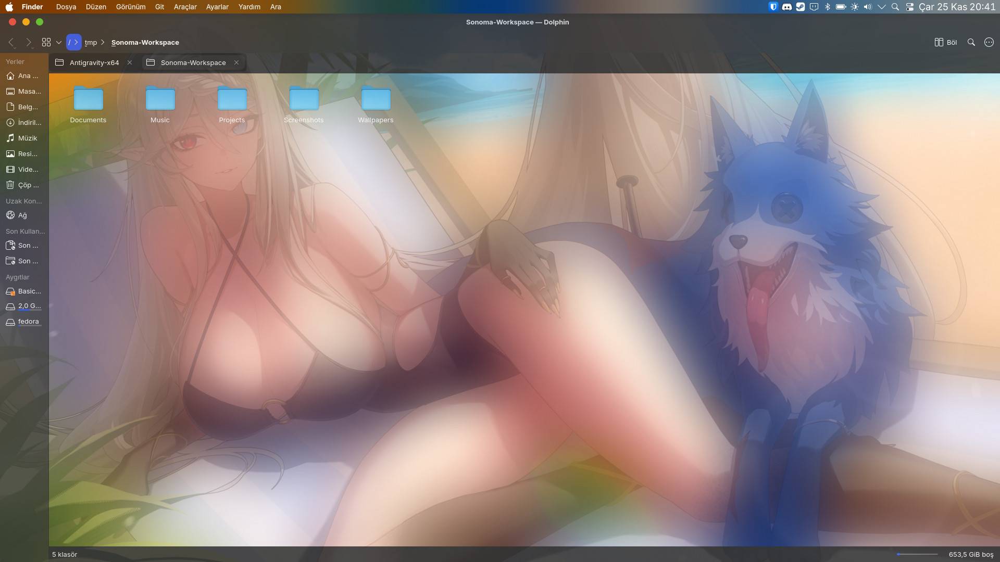
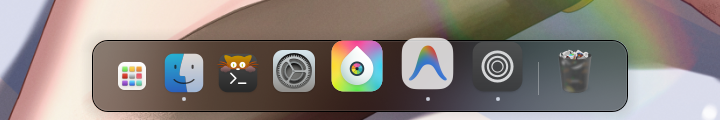

<div align="center">

# 🍎 Sonoma Plasma

**macOS Sonoma Experience for KDE Plasma 6 (Wayland) • Cosine-Wave Dock • Burn My Windows Aura Glow • Vibrancy Glass • macOS Control Center**

[-1d99f3?style=for-the-badge&logo=kde&logoColor=white)](https://kde.org/plasma-desktop/)
[](https://github.com/vinceliuice/WhiteSur-kde)
[](https://github.com/Schneegans/Burn-My-Windows)
[](#-macos-control-center)
[](#-installation--kurulum)
[](./LICENSE)

> **Foundational Credits / Taban Projeler:** Built on top of [**vinceliuice/WhiteSur-kde**](https://github.com/vinceliuice/WhiteSur-kde), [**WhiteSur-icon-theme**](https://github.com/vinceliuice/WhiteSur-icon-theme), [**WhiteSur-cursors**](https://github.com/vinceliuice/WhiteSur-cursors), [**Schneegans/Burn-My-Windows**](https://github.com/Schneegans/Burn-My-Windows) (Aura Glow), and [**Darkly**](https://github.com/Bali10050/Darkly) — extended with custom Plasma 6 QML widgets (magnified macOS Dock, active-app Finder menu bar, 2-pill Control Center button), selective macOS Vibrancy glass rules, and a dedicated PySide6/QtQuick **macOS Control Center**.

[**🇬🇧 English**](#-english-guide) • [**🇹🇷 Türkçe Rehber**](#-türkçe-rehber) • [**⌨️ Shortcuts**](#-keyboard-shortcuts--kısayollar) • [**🙏 Credits**](#-credits--attribution--teşekkür)


</div>

---

## 📸 Showcase Gallery / Ekran Görüntüleri

| Dolphin (Finder) — Selective Vibrancy Glass & Global Menu | macOS Control Center (PySide6 / QtQuick) |
| :---: | :---: |
|  |  |

<div align="center">

### Custom Plasma 6 Floating Dock — Smooth Cosine Hover Magnification (`44px → 64px`)


</div>

---

## 🇬🇧 English Guide

### ✨ Key Highlights

| Feature | Description |
| :--- | :--- |
| **🖥️ Authentic macOS Sonoma Top Bar** | Slim `26px` translucent menu bar with Apple menu (`kicker`), custom **`com.nexus.macosmenubar`** (bold active application name + working `Finder  File  Edit  View  Go  Window  Help` desktop menu), live Global Menu (`appmenu`), minimal monochrome tray, Spotlight (`milou`), custom 2-pill **`com.nexus.macoscontrolcenter`** button, and single-line `ddd d MMM HH:mm` clock. |
| **🚀 Custom Magnified macOS Dock** | Custom Plasma 6 `TaskManager.TasksModel` plasmoid (**`com.nexus.macosdock`**) with floating frosted-glass capsule, `roundToIconSize: false` continuous **`44px → 64px` cosine hover magnification**, running-app dot indicators, hairline divider, Launchpad (`view-app-grid`), and full-color Trash. |
| **✨ Burn My Windows — Aura Glow & Magic Lamp** | User-space KWin 6 (GLES 3.20 / HDR) **Burn My Windows Aura Glow** window open/close animation paired with `magiclamp` (Genie minimize, `280ms`), `sheet`, `slide`, `overview` (Mission Control), and `windowview` (App Exposé). |
| **🪟 Selective macOS Vibrancy Glass** | `Darkly` (`TransparentDolphinView`, `MenuOpacity=84`, `DolphinSidebarOpacity=72`, `CornerRadius=12`) + KWin Blur (`BlurStrength=11`, `NoiseStrength=2`) + selective `kwinrulesrc` vibrancy on Dolphin, System Settings, Konsole, Kitty, and Control Center — keeping browsers, media, and editors 100% opaque and crisp. |
| **🎛️ macOS Control Center (`Meta+I`)** | Dedicated PySide6 / QtQuick app managing **8 categories & 34 live settings** (Dark/Light 5-layer toggle, Dock/Bar live geometry, Blur & Darkly live D-Bus reload, Glow/Magic Lamp/Spaces, Wallpaper & Lockscreen, Cursor & ShakeCursor guard, Typography, Profiles, SHA-256 Undo, and Baseline Reset). |
| **🖱️ Permanent Growing-Cursor Fix** | Disables Plasma 6's `shakecursor` effect (`shakecursorEnabled=false`) and pins `WhiteSur-cursors` at `24px` across KDE, GTK 2/3/4, and Wayland. |
| **🛡️ Always-Awake Ergonomics** | Screen auto-lock and lock-on-resume are disabled by default (`Autolock=false`, `LockOnResume=false`, `Timeout=0`) with the bundled `2504×1408` wallpaper (`wallpapers/default.jpg`) applied to both desktop and lockscreen. |

### 📁 Repository Layout

```text
sonoma-plasma/
├── install.sh                            # Multi-distro installer (Fedora / Arch / Ubuntu) with backup & --dry-run
├── scripts/
│   └── uninstall.sh                      # Clean rollback to pre-install KDE Plasma backup
├── README.md                             # Bilingual EN/TR guide & shortcuts
├── LICENSE                               # MIT License
├── wallpapers/
│   └── default.jpg                       # Bundled default desktop & lockscreen wallpaper (2504×1408)
├── assets/screenshots/                   # Live captures of this exact setup
│   ├── desktop.png
│   ├── dock-magnification.png
│   ├── dolphin-vibrancy.png
│   └── control-center.png
├── config/                               # Sanitized KDE Plasma 6 & GTK 2/3/4 configs (__HOME__ templates)
│   ├── kwinrc, kwinrulesrc, darklyrc
│   ├── kdeglobals, plasmarc, plasmashellrc, plasma-org.kde.plasma.desktop-appletsrc
│   ├── kglobalshortcutsrc, krunnerrc, kscreenlockerrc, kcminputrc, kded6rc
│   └── gtk-3.0/, gtk-4.0/, gtkrc-2.0
└── local/                                # Deployed into ~/.local/share/
    ├── kwin/effects/glow/                # Burn My Windows Aura Glow KWin 6 effect (GLES 3.20 / HDR)
    ├── plasma/plasmoids/                 # com.nexus.macosdock, com.nexus.macosmenubar, com.nexus.macoscontrolcenter
    ├── control-center/                   # PySide6/QtQuick macOS Control Center + unittest suite
    ├── applications/                     # Desktop launcher entry
    └── sddm/                             # Optional WhiteSur SDDM login theme + apply/rollback scripts
```

---

## 🚀 Installation / Kurulum

```bash
git clone https://github.com/sudoivonx/sonoma-plasma.git
cd sonoma-plasma

# Preview every change safely first:
./install.sh --dry-run

# Run full installation (backs up your existing configs automatically):
./install.sh
```

### Installer Flags / Kurulum Seçenekleri
- `--dry-run` — Simulate without modifying any files or installing packages.
- `--skip-packages` — Skip distro package manager (`dnf` / `pacman` / `apt`).
- `--skip-themes` — Skip cloning/installing WhiteSur KDE, Icon, and Cursor themes.
- `--with-sddm` — Also install the bundled macOS SDDM login theme (requires `sudo`).
- `--no-backup` — Skip pre-install config backup.
- `-y, --yes` — Non-interactive mode.

### Rollback / Geri Alma
```bash
./scripts/uninstall.sh
# If you enabled SDDM:
sudo ~/.local/share/kde-macos/sddm/rollback-sddm-macos.sh
```

---

## ⌨️ Keyboard Shortcuts / Kısayollar

| Shortcut | Action (EN) | İşlev (TR) |
| :--- | :--- | :--- |
| `Meta + Space` / `Alt + Space` | Spotlight Search (KRunner) | Spotlight Arama (Ekran Ortası) |
| `Meta + Up` / `Meta + Tab` | Mission Control (Overview) | Mission Control (Genel Bakış) |
| `Meta + Down` | App Exposé (Current App) | Uygulama Exposé |
| `Ctrl + Left` / `Ctrl + Right` | Switch Spaces (Desktops) | Sanal Masaüstleri Arası Geçiş |
| `Meta + A` | Launchpad | Launchpad (Uygulama Izgarası) |
| `Meta + I` | macOS Control Center | macOS Kontrol Merkezi (Ayarlar) |

---

## 🇹🇷 Türkçe Rehber

### Öne Çıkan Özellikler
- **macOS Sonoma Üst Barı:** `26px` ince buzlu cam üst çubuk, sol üstte Apple menüsü, aktif uygulama adını kalın gösteren ve masaüstünde **`Finder  File  Edit  View  Go  Window  Help`** menüsü sunan özel eklenti (`com.nexus.macosmenubar`), canlı Global Menü, sadeleştirilmiş sistem tepsisi, Spotlight, iki anahtarlı Kontrol Merkezi simgesi (`com.nexus.macoscontrolcenter`) ve tek satır tarih/saat.
- **Büyüyen macOS Dock (`com.nexus.macosdock`):** Yüzen buzlu cam kapsül, üzerine gelindiğinde komşu simgelerle birlikte akıcı kosinüs dalgasıyla büyüyen (`44px → 64px`) simgeler, çalışan uygulama nokta göstergeleri, renkli Launchpad ve tam renkli macOS Çöp Kutusu.
- **Burn My Windows — Aura Glow & Magic Lamp:** KWin 6 (Wayland / GLES 3.20) uyumlu **Burn My Windows Aura Glow** açılış/kapanış efekti ve macOS Genie (`magiclamp`) küçültme animasyonu.
- **Seçici macOS Vibrancy Cam Efekti:** Dolphin, Sistem Ayarları, Konsole, Kitty ve Kontrol Merkezi pencerelerinde buzlu cam saydamlığı (`Darkly` + KWin Blur + `kwinrulesrc`); tarayıcı ve medya uygulamalarında tam opak okunabilirlik.
- **macOS Kontrol Merkezi (`Meta+I`):** 8 kategori ve 34 canlı ayarla (Koyu/Açık tema, Dock/Üst Bar, Bulanıklık & Darkly, Glow/Magic Lamp/Spaces, Duvar Kağıdı & Kilit Ekranı, İmleç & ShakeCursor koruması, Yazı Tipleri, Profiller ve SHA-256 Geri Alma) tüm masaüstünü tek pencereden yönetir.
- **Büyüyen İmleç Hatası Çözümü:** Plasma 6'nın `shakecursor` efekti devre dışı bırakılır ve `WhiteSur-cursors` `24px` olarak sabitlenir.

---

## 🙏 Credits & Attribution / Teşekkür

This project builds upon and credits the following outstanding open-source projects:
- [**vinceliuice/WhiteSur-kde**](https://github.com/vinceliuice/WhiteSur-kde) — macOS WhiteSur Plasma theme, Aurorae window decoration, color schemes, and SDDM base theme.
- [**vinceliuice/WhiteSur-icon-theme**](https://github.com/vinceliuice/WhiteSur-icon-theme) — macOS icon theme.
- [**vinceliuice/WhiteSur-cursors**](https://github.com/vinceliuice/WhiteSur-cursors) — macOS cursor theme.
- [**Schneegans/Burn-My-Windows**](https://github.com/Schneegans/Burn-My-Windows) — Upstream **Aura Glow** shader effect adapted for KWin 6 Wayland.
- [**Bali10050/Darkly**](https://github.com/Bali10050/Darkly) — Translucent Qt 6 / KDE application style.
- **KDE Community** — KDE Plasma 6, KWin 6, and Kirigami.
