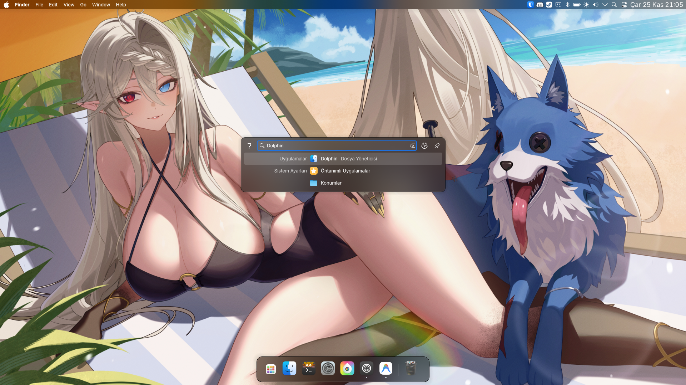
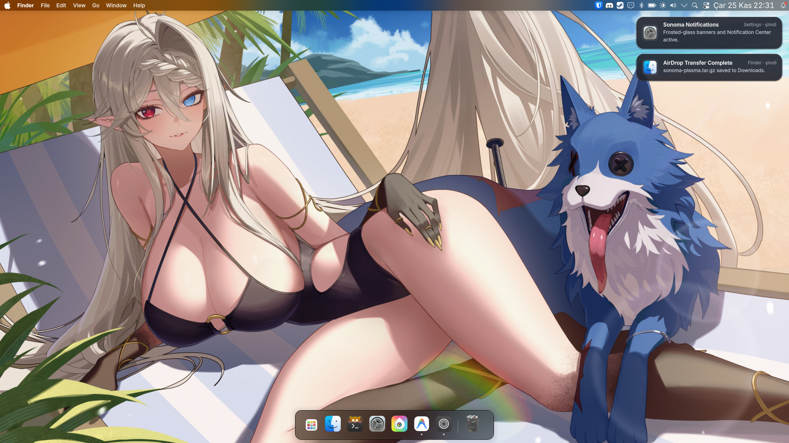

# Sonoma Plasma — Türkçe Kurulum ve Kullanım Rehberi

> **KDE Plasma 6 (Wayland)** için baştan sona özenle hazırlanmış macOS Sonoma masaüstü kurulumu: kosinüs dalgalı büyüyen Dock, aktif uygulamayı gösteren Finder üst menü çubuğu, buzlu cam **macOS Sonoma bildirimleri**, **Burn My Windows — Aura Glow**, seçici buzlu cam (Vibrancy) ve yerel QtQuick Kontrol Merkezi.

[🇬🇧 English README](../README.md) · [⚙️ Özelleştirme Rehberi](CUSTOMIZATION.md)



---

## Öne Çıkanlar

- **Gerçekçi macOS Sonoma Üst Barı (`26px`):** Sol üstte Apple menüsü, odaklanılan uygulamayı kalın başlıkla gösteren ve boş masaüstünde çalışan **`Finder  File  Edit  View  Go  Window  Help`** menüsü sunan `com.nexus.macosmenubar`, canlı Global Menü (`appmenu`), sade sistem tepsisi, Spotlight arama büyüteci, iki anahtarlı Kontrol Merkezi simgesi (`com.nexus.macoscontrolcenter`) ve tek satır tarih/saat.
- **Kosinüs Dalgalı Büyüyen Dock (`44px → 64px`):** Plasma 6 `TaskManager.TasksModel` tabanlı `com.nexus.macosdock` eklentisi; `roundToIconSize: false` sayesinde takılmadan kesintisiz büyüyen simgeler, renkli Launchpad, çalışan uygulama nokta göstergeleri ve tam renkli Çöp Kutusu.
- **macOS Sonoma Bildirimleri ve Bildirim Merkezi (`com.nexus.macosnotifications`):** Varsayılan KDE bildirimleri yerine sağ üstte beliren buzlu cam yuvarlatılmış (`18px`) bildirim kartları, sol `40×40` uygulama simgesi, üzerine gelince açılan `×` kapatma kapsülü, Koyu/Açık tema uyumu ve üst bar Bildirim Merkezi çekmecesi.
- **Burn My Windows — Aura Glow & Magic Lamp:** KWin 6 (Wayland / GLES 3.20) kullanıcı alanına kurulan **Burn My Windows Aura Glow** açılış/kapanış efekti + `magiclamp` (`280ms`) Genie küçültme animasyonu.
- **Seçici macOS Vibrancy Cam Efekti:** Dolphin, Sistem Ayarları, Konsole, Kitty ve Kontrol Merkezi pencerelerinde buzlu cam saydamlığı (`Darkly` + KWin Blur + `kwinrulesrc`); tarayıcı, video ve kod editörlerinde göz yormayan `%100` opak okunabilirlik.
- **macOS Kontrol Merkezi (`Meta + I`):** 8 kategori, 34 canlı ayar, tek tık Koyu/Açık 5 katmanlı tema geçişi, animasyon profilleri, profil kaydetme/yükleme ve SHA-256 korumalı **Geri Al (Undo)** / **Sıfırla**.



---

## Kurulum

```bash
git clone https://github.com/sudoivonx/sonoma-plasma.git
cd sonoma-plasma

# Önce tüm adımları güvenle önizleyin:
./install.sh --dry-run

# Mevcut ayarlarınızı otomatik yedekleyerek kurun:
./install.sh
```

İsteğe bağlı SDDM giriş ekranı temasını da uygulamak için `./install.sh --with-sddm` kullanabilirsiniz.

## Geri Alma (Kaldırma)

```bash
./scripts/uninstall.sh
# SDDM kurulduysa:
sudo ~/.local/share/kde-macos/sddm/rollback-sddm-macos.sh
```

---

## Klavye Kısayolları

| Kısayol | İşlev |
| :--- | :--- |
| `Meta + Space` / `Alt + Space` | Spotlight Arama (Ekran ortasında yüzen KRunner) |
| `Meta + Up` / `Meta + Tab` | Mission Control (Genel Bakış & Masaüstleri) |
| `Meta + Down` | Uygulama Exposé (Geçerli uygulamanın pencereleri) |
| `Ctrl + Left` / `Ctrl + Right` | Sanal Masaüstleri (Spaces) Arası Geçiş |
| `Meta + A` | Launchpad (Tam ekran uygulama ızgarası) |
| `Meta + I` | macOS Kontrol Merkezi |

---

## Açık Kaynak Atıfları

- [**vinceliuice/WhiteSur-kde**](https://github.com/vinceliuice/WhiteSur-kde), [**WhiteSur-icon-theme**](https://github.com/vinceliuice/WhiteSur-icon-theme) ve [**WhiteSur-cursors**](https://github.com/vinceliuice/WhiteSur-cursors)
- [**Schneegans/Burn-My-Windows**](https://github.com/Schneegans/Burn-My-Windows) (Aura Glow)
- [**Bali10050/Darkly**](https://github.com/Bali10050/Darkly)
- **KDE Topluluğu** (KDE Plasma 6, KWin 6, Kirigami)
